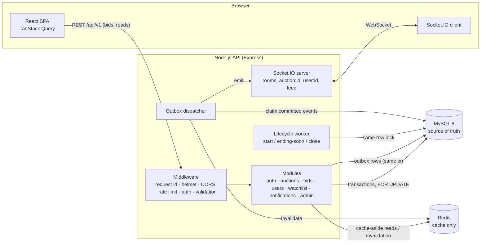
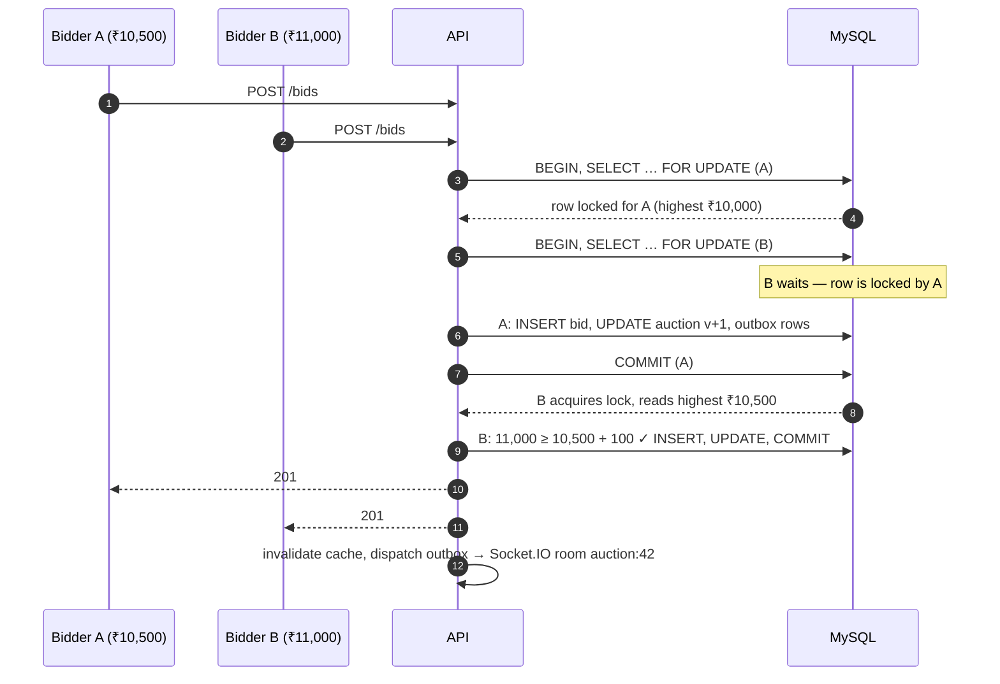
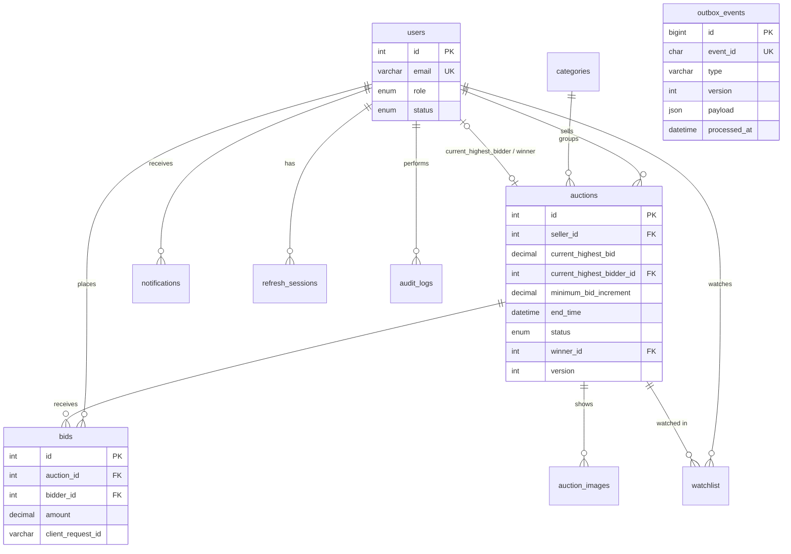
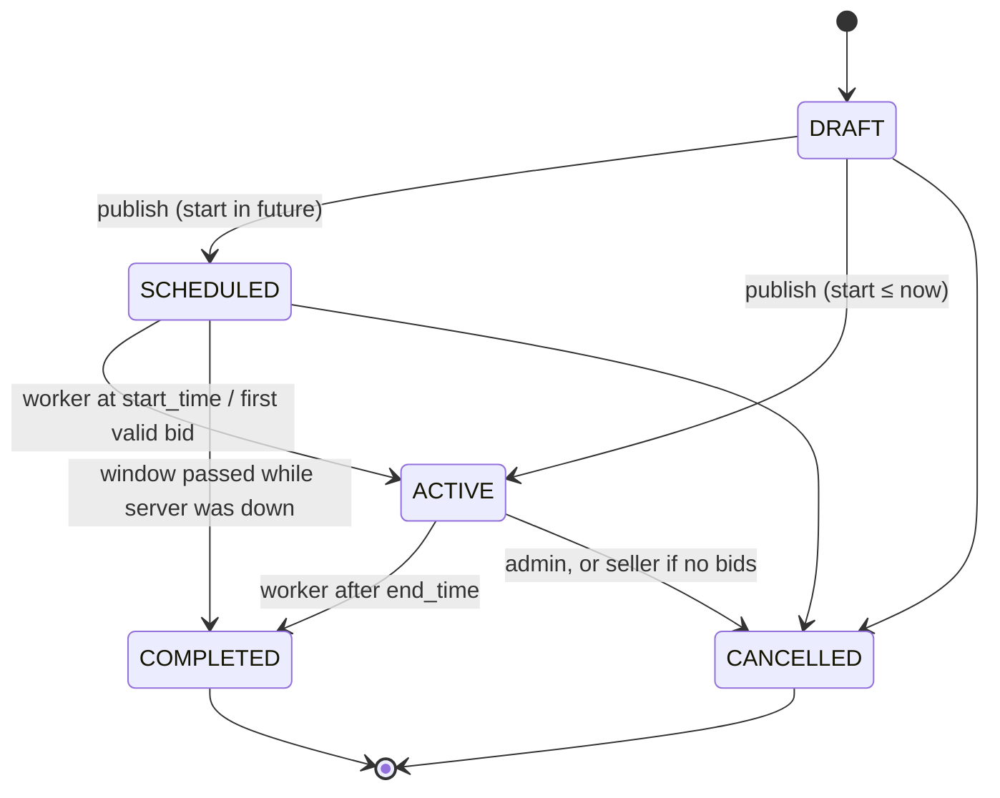
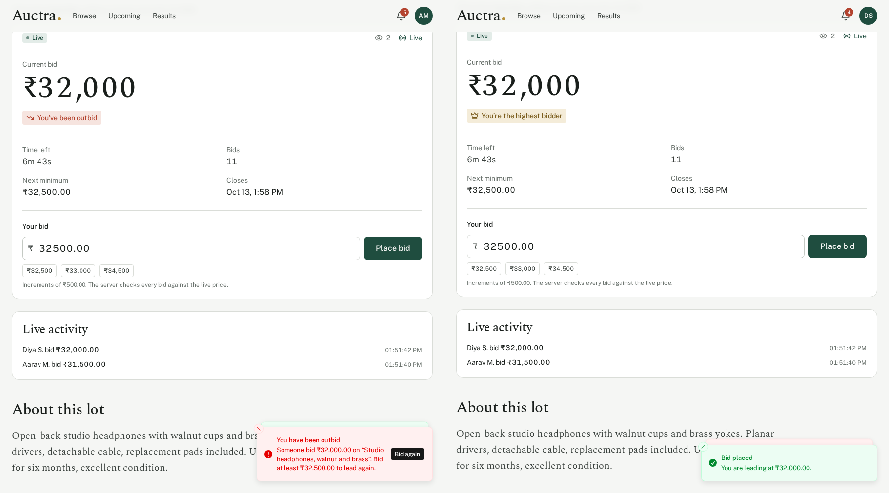
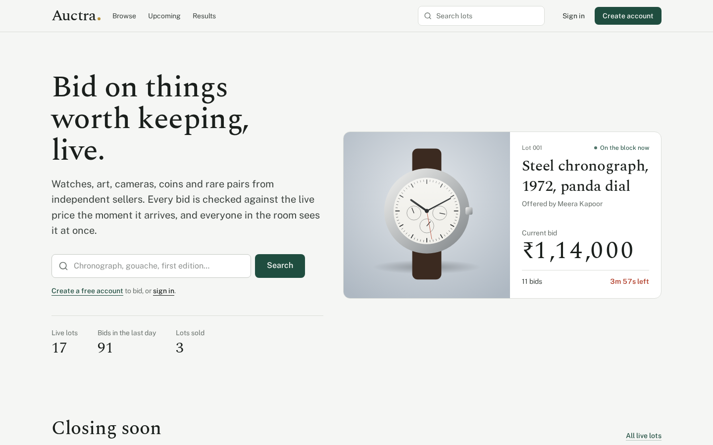
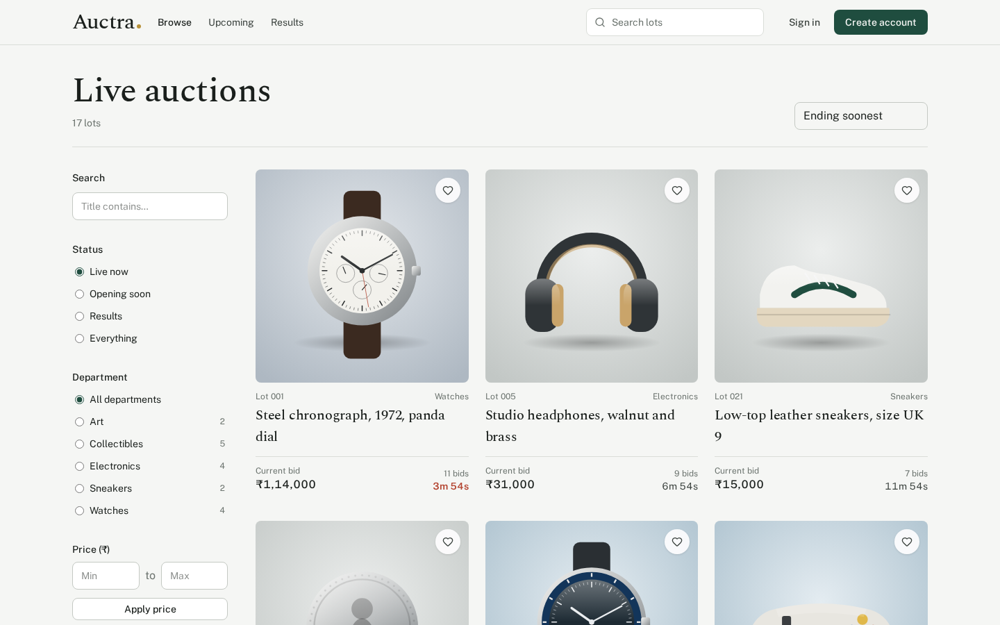
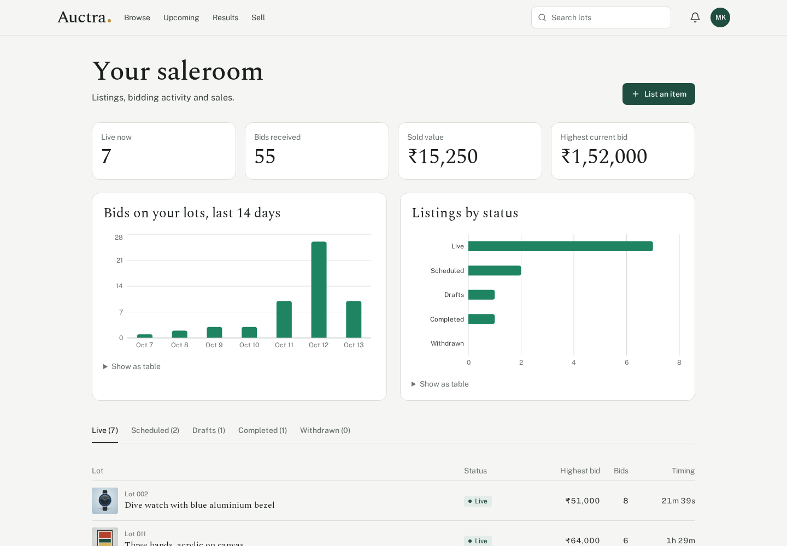
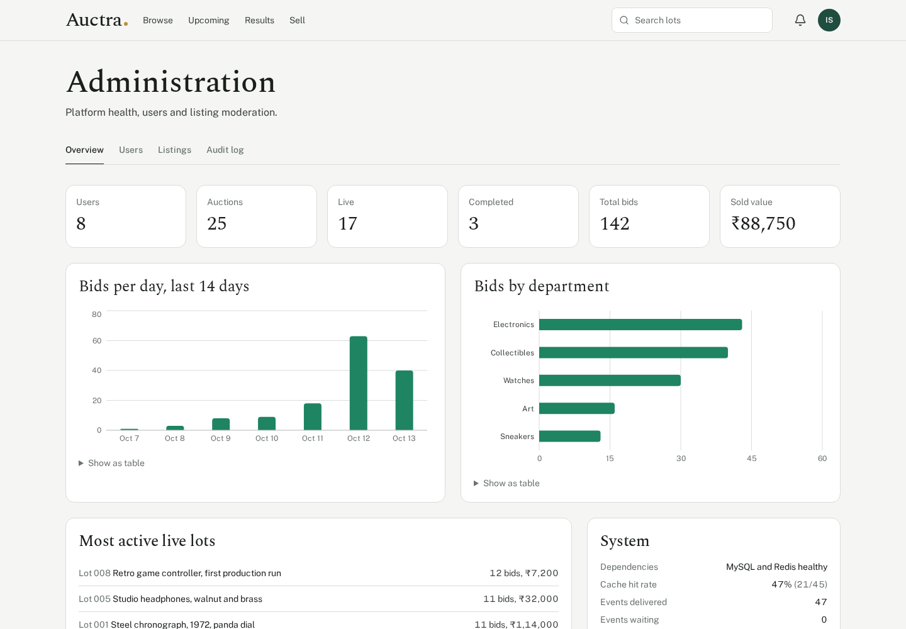

# Auctra — Real-Time Online Auction Platform

Auctra is a full-stack online auction house: sellers list items, bidders compete in real time, and
everyone watching a lot sees each accepted bid the moment it commits. It is built as a portfolio
project whose engineering centre is **correct bidding under concurrency** — two people bidding at the
same instant must never corrupt the auction.

React · TypeScript · Node.js · Express · MySQL 8 · Redis · Socket.IO · Kysely · Vitest · Playwright

> **One deviation from the original brief:** the data layer uses **Kysely + mysql2** (type-safe SQL)
> with plain `.sql` migrations instead of **Prisma**. Prisma downloads Rust engine binaries at
> install/run time from `binaries.prisma.sh`, which was blocked in the environment this was built in,
> so a Prisma implementation could not be run or tested there. Kysely is pure TypeScript, so every
> migration, query and test in this repo was actually executed against real MySQL. A side benefit:
> the locking SQL (`SELECT … FOR UPDATE`) is written out explicitly, which makes it easy to explain.

---

## Contents

1. [Project overview](#1-project-overview) · 2. [Core features](#2-core-features) · 3. [Technology stack](#3-technology-stack)
4. [System architecture](#4-system-architecture) · 5. [Request lifecycle](#5-request-lifecycle) · 6. [Bidding transaction flow](#6-bidding-transaction-flow)
7. [Database design](#7-database-design) · 8. [Authentication and RBAC](#8-authentication-and-rbac) · 9. [Redis caching](#9-redis-caching)
10. [WebSockets](#10-websockets) · 11. [Auction lifecycle](#11-auction-lifecycle) · 12. [API](#12-api-documentation)
13. [Local setup (Windows)](#13-local-setup) · 14. [Demo credentials](#14-demo-credentials) · 15. [Five-minute demo](#15-five-minute-demo)
16. [Testing](#16-testing) · 17. [Performance results](#17-performance-results) · 18. [Security](#18-security)
19. [Scalability](#19-scalability) · 20. [Future improvements](#20-future-improvements) · 21. [Decisions and trade-offs](#21-technical-decisions-and-trade-offs)
22. [Resume alignment](#22-resume-alignment) · 23. [Screenshots](#23-screenshots)

Deep dives live in [`docs/`](docs): [Architecture](docs/ARCHITECTURE.md), [Database](docs/DATABASE.md),
[Bidding concurrency](docs/BIDDING_CONCURRENCY.md), [API](docs/API.md), [Redis & WebSockets](docs/REDIS_WEBSOCKETS.md),
[Security](docs/SECURITY.md), [Testing](docs/TESTING.md), [Demo guide](docs/DEMO_GUIDE.md),
[System design](docs/SYSTEM_DESIGN.md) and the [Interview prep guide](docs/INTERVIEW_PREP.md).

---

## 1. Project overview

Online auctions have one hard problem hiding behind a simple UI: **many people write to the same
row at the same time.** If two bids are validated against the same stale "current highest bid", the
lower one can overwrite the higher one (a *lost update*), or a bid can slip in after the auction was
already awarded to someone else.

Auctra solves this with MySQL transactions and row-level locking, then layers Redis caching (for
read-heavy traffic) and Socket.IO (for live updates) on top **without ever letting the cache or the
socket decide a bidding outcome**. MySQL is the single source of truth.

## 2. Core features

**For bidders** — browse with search, department, price and status filters and five sort orders;
live auction pages with a rolling price, countdown, bid history, live activity feed and viewer count;
bid confirmation; instant outbid alerts; watchlist; dashboard of winning / outbid / won / lost lots;
notification centre.

**For sellers** — create listings with image upload, save drafts, schedule or publish immediately,
edit drafts and scheduled lots, cancel within the rules, seller dashboard with charts.

**For administrators** — platform statistics, user management (suspend, change role), listing
moderation (feature, reject, cancel with reason), audit log, live diagnostics (cache hit rate,
outbox backlog, dependency health).

**Backend capabilities** — versioned REST API (`/api/v1`) with OpenAPI docs; JWT access tokens plus
rotating HttpOnly refresh cookies with reuse detection; RBAC; concurrency-safe bidding with
idempotency keys and deadlock retries; explicit auction state machine with a lifecycle worker;
transactional outbox for durable post-commit events; versioned cache-aside in Redis; Socket.IO rooms;
structured logs with request IDs; health checks; rate limiting.

## 3. Technology stack

| Layer | Choice | Why |
|---|---|---|
| UI | **React 19** + Vite + TypeScript | Component model fits a page that re-renders on every live event; huge ecosystem; Vite gives instant dev reloads. |
| Styling | Tailwind CSS 4 + Radix primitives | Design tokens in one place; Radix gives accessible menus, dialogs and tabs without imposing a look. |
| Server state | TanStack Query | Caching, refetch-on-focus and an imperative cache we can patch from socket events. |
| API server | **Node.js 22** + **Express 5** | One language end to end; Node's event loop suits many concurrent, I/O-bound connections (HTTP + WebSockets). Express is small and well understood; v5 forwards async errors to the error handler. |
| Database | **MySQL 8 (InnoDB)** | Bidding needs ACID transactions and row-level locks (`SELECT … FOR UPDATE`) — exactly what InnoDB provides. The data is relational (users, auctions, bids, watchlists). |
| Why not MongoDB? | — | MongoDB has transactions now, but the domain is relational with strong invariants (FKs, unique keys, CHECK constraints) and the core operation is "lock one row, validate, write two tables atomically". A relational database expresses that directly. |
| Data access | **Kysely + mysql2** | Type-checked SQL builder; raw SQL where it matters (the lock). See the note above about Prisma. |
| Cache | **Redis 7** | In-memory key/value store for hot, read-mostly snapshots; Lua scripts give atomic compare-and-set for versioned cache writes. |
| Real time | **Socket.IO 4** | WebSockets with automatic reconnection, rooms and HTTP long-polling fallback. |
| Validation | Zod | One schema validates and types each request. |
| Auth | jsonwebtoken + bcryptjs | Short-lived signed access tokens; adaptive password hashing. |
| Logging | Pino | Fast structured JSON logs with redaction. |
| Tests | Vitest, Supertest, socket.io-client, Testing Library, Playwright | Unit → API → concurrency → socket → component → browser E2E. |
| Infra | Docker Compose | MySQL and Redis with health checks in one command, identical on every machine. |
| Language | **TypeScript** everywhere | Shared event contracts, typed SQL, refactors caught at compile time. |

## 4. System architecture

A **modular monolith**: one deployable API with clearly separated modules, plus two in-process
background workers. Simple to run, easy to reason about, and each module could be extracted later.



Folder layout:

```text
backend/
  database/migrations/001_init.sql   schema, FKs, unique keys, CHECK constraints, indexes
  database/seed/                     repeatable demo seed + artwork generator
  src/modules/{auth,auctions,bids,users,watchlist,notifications,admin,categories,uploads,dev}
  src/middleware/                    requestContext, auth (authenticate/requireRole/csrf), validate, errorHandler, rateLimit
  src/cache/                         redis client, versioned cache-aside, keys, metrics
  src/sockets/io.ts                  Socket.IO server, room auth, publisher
  src/workers/                       lifecycleWorker.ts, outboxDispatcher.ts
  src/services/                      outbox, notifications, audit, health
  src/shared/events.ts               typed socket event contracts
  tests/{unit,integration,concurrency}
frontend/
  src/features/bidding/              useLiveAuction (socket + versions), applyEvent (pure reducer), BidPanel
  src/services/                      api client (token refresh), socket singleton, query keys
  src/pages/                         Home, Browse, Auction, Auth, Dashboard, Sell, Seller, Admin
  e2e/                               Playwright multi-session live bidding test
scripts/                             race demo, cache demo, lifecycle demo, autocannon benchmark
docs/                                deep dives and interview prep
```

## 5. Request lifecycle

Taking `POST /api/v1/auctions/42/bids` as the example (`backend/src/app.ts` sets the order):

1. **requestContext** assigns a request ID (`X-Request-Id`) and starts a per-request SQL counter.
2. **pino-http** logs the request (tokens and cookies redacted).
3. **helmet** sets security headers; **cors** enforces the origin allow-list.
4. **express.json** parses the body (100 kB limit); **cookie-parser** reads cookies.
5. **apiLimiter** (global), then on this route **authenticate** (verify JWT, load the user's current
   role/status from MySQL), **bidLimiter** (per user), **validateRequest** (Zod: params + body).
6. **Controller** (`auction.routes.ts`) maps HTTP to a service call — no business rules here.
7. **Service** (`bids/bid.service.ts → placeBid`) runs the transaction (next section).
8. Response `201` (new bid) or `200` (idempotent replay) with `{ success, data }`; headers include
   `X-DB-Queries`, `X-Cache` (on cached reads) and `Server-Timing`.
9. Any thrown `AppError` becomes `{ success: false, error: { code, message, details, requestId } }`
   in **errorHandler**; unexpected errors are logged in full and returned as a generic 500.

## 6. Bidding transaction flow

Implemented in [`backend/src/modules/bids/bid.service.ts`](backend/src/modules/bids/bid.service.ts).

```text
0  validate amount format, precision (≤ 2 dp) and range           — outside the transaction
1  BEGIN  (READ COMMITTED)
2  SELECT … FROM auctions WHERE id = ? FOR UPDATE   ← row lock + UTC_TIMESTAMP(3) (DB clock)
3  idempotency: SELECT bid WHERE (bidder_id, client_request_id) → replay returns original result
4  rules on the LOCKED row: exists · not own auction · status · start ≤ now < end · amount ≥ minimum
5  INSERT bid (created_at = DB clock)
6  UPDATE auctions SET highest, leader, bid_count+1, version+1 WHERE id = ? AND version = ?
7  INSERT notifications, outbox events, audit row        — same transaction
8  COMMIT                                               ← lock released
9  invalidate Redis (versioned) · wake outbox dispatcher → Socket.IO broadcast
   deadlock (1213) / lock-wait timeout (1205) → roll back, retry whole tx (≤ 3, jittered backoff)
```

**Why the lock is needed.** Without it, two requests can both read "highest = ₹10,000", both pass
validation, and the later write wins even if it is the lower bid. `npm run demo:race` runs the
naive version side-by-side and shows exactly that lost update (₹11,000 bid stored, summary says
₹10,500). With `FOR UPDATE`, the second transaction **blocks** on the row until the first commits,
then reads the new highest bid and re-validates.

**Where the lock is acquired:** `lockAuction()` in
[`auction.repository.ts`](backend/src/modules/auctions/auction.repository.ts). It is a primary-key
lookup, so InnoDB locks a single index record: bids on *other* auctions are not blocked (a test
proves this).



If B had locked first, A would re-read ₹11,000 after waiting and be rejected with `BID_TOO_LOW` —
both orderings are legal; an inconsistent end state is not. Full write-up:
[docs/BIDDING_CONCURRENCY.md](docs/BIDDING_CONCURRENCY.md).

## 7. Database design



Key points (details in [docs/DATABASE.md](docs/DATABASE.md)):

- Money is `DECIMAL(12,2)` (INR), never `FLOAT`. mysql2 returns it as a string; arithmetic uses
  decimal.js on the server and integer paise (`BigInt`) in the UI.
- All times are `DATETIME(3)` in UTC; the connection forces `time_zone = '+00:00'`.
- `UNIQUE (bidder_id, client_request_id)` makes idempotency a database guarantee.
- `CHECK` constraints: positive prices and bids, `end_time > start_time`,
  `current_highest_bid ≥ starting_price`, and "highest bid and leader are both set or both null".
- Indexes match the hot queries: `(status, end_time)` for the closing worker, `(auction_id, created_at)`
  for history, `(user_id, is_read, created_at)` for the notification bell.
- `auctions.version` increments on every state change; it orders socket events and guards the cache.

## 8. Authentication and RBAC

- **Passwords**: bcrypt (cost 12). Login always runs bcrypt — even for unknown emails — so response
  time does not reveal which emails exist; the error message is identical either way.
- **Access token**: 15-minute HS256 JWT with pinned algorithm, issuer and audience. The SPA keeps it
  **in memory only**.
- **Refresh token**: 256-bit random opaque value in an `HttpOnly; SameSite=Strict; Path=/api/v1/auth`
  cookie (`Secure` in production). Stored only as a SHA-256 hash. Every refresh **rotates** it; reuse
  of an already-rotated token revokes the entire token family (theft detection), with a 30 s grace
  window for two tabs refreshing at once. `/auth/refresh` and `/auth/logout` also require an
  `X-Auctra-CSRF: 1` header.
- **RBAC**: `USER < SELLER < ADMIN`. `authenticate` re-reads the user's role and status on every
  request, so suspensions take effect immediately. `requireRole` gates routes; ownership checks
  (IDOR protection) happen in services against the locked row. The full role–permission matrix is in
  [docs/SECURITY.md](docs/SECURITY.md).

## 9. Redis caching

**Cache-aside**: read Redis → on a miss load from MySQL and store with a TTL → on a write, commit to
MySQL **first**, then invalidate.

| Key | Holds | TTL |
|---|---|---|
| `auctra:v1:auction:detail:{id}` | auction detail snapshot (with `version`) | 60 s |
| `auctra:v1:auction:minver:{id}` | lowest version allowed back into the cache | 300 s |
| `auctra:v1:auctions:list:{gen}:{hash}` | one browse-results page | 20 s |
| `auctra:v1:auctions:list:gen` | generation counter (INCR invalidates every list page) | — |
| `auctra:v1:auctions:featured` / `categories:all` / `stats:public` / `dashboard:summary` | aggregates | 30 s / 1 h / 30 s / 15 s |

**Versioned writes close the classic stale-repopulation race**: a slow reader that loaded version 5
cannot write it back after a bid committed version 6, because a Lua script compares versions inside
Redis atomically. Redis outages degrade to "slower" — every call is wrapped, and `X-Cache: BYPASS`
shows when it happened. **Bidding never reads the cache.** Every detail response carries
`X-Cache: HIT|MISS|BYPASS` and `X-DB-Queries`, so you can watch the cache work (`npm run demo:cache`).

## 10. WebSockets

- One shared Socket.IO connection per tab. Rooms: `auction:{id}` (lot events), `user:{id}`
  (private notifications, joined only with a valid token), `feed` (price ticks for listing cards).
- **Events are emitted only after commit**, by the outbox dispatcher. Every event carries a unique
  `eventId`, the auction `version` after the change, and a DB timestamp.
- **The client never trusts arrival order** (`frontend/src/features/bidding/applyEvent.ts`):
  `version ≤ current` → ignore; `= current + 1` → apply; `> current + 1` → gap → refetch over REST.
- **Reconnection**: socket.io-client reconnects with backoff; on `connect` the page re-joins its room;
  the join acknowledgement returns the server's current version, and if it's ahead the page refetches.
- Listeners are registered in one effect and removed in its cleanup; rooms are sets, so a duplicate
  join is a no-op.
- **Bids are never sent over the socket** — only through the authenticated, validated REST endpoint.

## 11. Auction lifecycle



The lifecycle worker (`backend/src/workers/lifecycleWorker.ts`) polls every second with indexed
queries, then **locks each candidate row with the same `FOR UPDATE` as bidding** and re-checks before
acting. That makes closing and bidding strictly serialised, transitions idempotent (several workers
can run), and restarts safe (the first tick closes anything that ended while the server was down).
The bid path checks `now < end_time` with the database clock on its own, so even a late worker can
never let a bid in after the end. When an auction closes, the winner, seller and losing bidders are
notified in the same transaction. Optional anti-sniping (`ANTI_SNIPE_WINDOW_SECONDS`) extends the end
time inside the bid transaction; it is off by default.

## 12. API documentation

- Interactive OpenAPI docs: **http://localhost:4000/api/docs** (spec at `/api/openapi.json`).
  A test asserts every documented path is actually routed.
- Endpoint reference with example requests and every error code: [docs/API.md](docs/API.md).

```bash
# log in (refresh cookie is set; access token is in the body)
curl -s -c jar.txt -X POST localhost:4000/api/v1/auth/login \
  -H 'content-type: application/json' -d '{"email":"aarav@auctra.dev","password":"Auctra@2026"}'

# place a bid (idempotent: reuse the same clientRequestId when retrying)
curl -s -X POST localhost:4000/api/v1/auctions/5/bids \
  -H "authorization: Bearer $TOKEN" -H 'content-type: application/json' \
  -d '{"amount":"32000.00","clientRequestId":"3f1c2a8e-6c7b-4f0e-9d1a-0b6f0c5e9a11"}'
```

## 13. Local setup

**Prerequisites:** Node.js 20.19+ (22 LTS recommended) with npm 10+, Docker Desktop, Git.
Development ports: web **5173**, API **4000**, MySQL **3307**, Redis **6380** (host ports chosen so they
don't clash with a MySQL/Redis you may already run).

```powershell
git clone https://github.com/satyadamera/AuctionHouse.git
cd AuctionHouse
copy .env.example backend\.env          # macOS/Linux: cp .env.example backend/.env
docker compose up -d                    # MySQL 8 + Redis 7, waits on health checks
npm install
npm run db:migrate                      # applies database/migrations/*.sql
npm run db:seed                         # 25 lots, 8 accounts, bid histories (repeatable)
npm run dev                             # API :4000 + web :5173
```

Open **http://localhost:5173**. `npm run dev` also applies pending migrations on start.

| Command | What it does |
|---|---|
| `npm run dev` | API (tsx watch) and web (Vite) together |
| `npm run build` | Compile backend to `backend/dist`, build frontend to `frontend/dist` |
| `npm run test` | Backend unit tests + frontend component tests (no database needed) |
| `npm run test:integration` | API, cache, lifecycle and socket tests against MySQL + Redis |
| `npm run test:concurrency` | Race, contention, close-vs-bid and real-deadlock tests |
| `npm run test:all` | All of the above |
| `npm run test:e2e` | Playwright, needs `npm run dev` running and a seeded DB |
| `npm run db:migrate` / `db:seed` / `db:reset` | Migrate / reseed / drop + migrate + seed |
| `npm run lint` / `typecheck` | ESLint / TypeScript across both packages |
| `npm run demo:race` / `demo:cache` / `demo:lifecycle` | The scripted demos (API must be running) |
| `npm run bench` | autocannon benchmark (self-contained; uses the test DB) |

The integration tests wipe the **test** database (`auctra_test`, created by `infra/mysql/init.sql`)
and refuse to run against a URL that doesn't contain "test".

## 14. Demo credentials

**Development only** — created by `npm run db:seed`, which refuses to run with `NODE_ENV=production`.
Every account's password is **`Auctra@2026`**. The login page shows one-click fill buttons in dev builds.

| Email | Role | Use it for |
|---|---|---|
| `aarav@auctra.dev` | Bidder | Demo user A |
| `diya@auctra.dev` | Bidder | Demo user B |
| `kabir@auctra.dev`, `ananya@auctra.dev`, `rohan@auctra.dev` | Bidder | More bidders |
| `meera@auctra.dev` | Seller | Watches, art, collectibles |
| `arjun@auctra.dev` | Seller | Electronics, sneakers |
| `admin@auctra.dev` | Admin | Dashboard, moderation |

## 15. Five-minute demo

1. **Live bidding (90 s).** Chrome window as Aarav, incognito window as Diya, same live lot
   (the home page hero is always one). Aarav bids; Diya's price rolls and the activity feed updates
   without a refresh. Diya bids higher; Aarav sees "You've been outbid" and a toast.
2. **The race (60 s).** `npm run demo:race` — both orderings of ₹10,500 vs ₹11,000, equal bids,
   idempotent retries, 50 concurrent bidders, and the naive no-lock version losing an update.
3. **Cache (45 s).** `npm run demo:cache` — MISS (2 SQL queries) → HIT (0) → bid → invalidated →
   MISS with fresh data matching MySQL.
4. **Closing (60 s).** `npm run demo:lifecycle` — a 20-second lot closes on the server, the winner gets
   `AUCTION_WON` over the socket, a late bid gets `AUCTION_ENDED`.
5. **Authorization (45 s).** As Rohan, open `/sell` → refused; as Meera, list an item; as admin, open
   `/admin` and reject a listing.

Step-by-step scripts and expected output: [docs/DEMO_GUIDE.md](docs/DEMO_GUIDE.md).

## 16. Testing

| Suite | Count | Runs against | Proves |
|---|---:|---|---|
| Backend unit | 50 | nothing | money maths, state machine, bid window boundaries, RBAC gate, JWT tampering/`alg:none`, schemas |
| API integration | 75 | MySQL + Redis | auth & refresh rotation & reuse detection, RBAC/IDOR, bidding rules & idempotency, lifecycle, cache, notifications, uploads, sockets, OpenAPI coverage |
| Concurrency | 17 | MySQL (real locks) | both race orderings (deterministic via a lock-held hook), 20/50/100-bidder contention, equal bids, concurrent duplicates, close-vs-bid, a real InnoDB deadlock and its retry |
| Frontend component | 16 | jsdom | event version reducer, money/format utils, bid panel states and error handling |
| Browser E2E | 3 | full stack + Chromium | two sessions bidding live, server-side rejection, route protection |

**The concurrency tests were checked for teeth:** with `FOR UPDATE` removed from `lockAuction`,
7 of the 14 race tests fail. Details and limitations: [docs/TESTING.md](docs/TESTING.md).

## 17. Performance results

Measured with `npm run bench` (autocannon, 50 connections, 10 s per scenario). **Environment:** a
2-vCPU Intel Xeon @ 2.8 GHz Linux VM, 8 GB RAM, Node 22.22, MySQL 8.0.46, Redis 7.0.15 — API,
databases and load generator all on the same machine, so absolute numbers are modest and noisy.

| Scenario | req/s | p50 | p90 | p99 |
|---|---:|---:|---:|---:|
| A. `GET /auctions/:id`, Redis warm | 1,559 | 27 ms | 46 ms | 68 ms |
| B. `GET /auctions/:id`, cache bypassed (MySQL every request) | 721 | 67 ms | 87 ms | 110 ms |
| C. `POST /bids`, 20 users over 20 auctions | 149 | 321 ms | 415 ms | 673 ms |
| D. `POST /bids`, 20 users on **one** auction (max lock contention) | 76 | 649 ms | 703 ms | 757 ms |

- **What was measured locally:** on this machine the warm cache roughly doubled detail-read
  throughput and cut median latency by more than half. An earlier run of the same benchmark gave
  1,341 vs 722 req/s, so treat the ratio as "about 2×", not a precise figure.
- **What it does not say:** production numbers. With the database on separate hardware and real
  network latency, the cache's relative benefit would usually be larger, but that was not measured.
- **Bids are deliberately slower:** each bid is a transaction of roughly ten statements (lock, checks,
  insert, update, notifications, outbox, audit) and same-auction bids queue on one row. Under maximum
  contention every accepted bid was persisted: after load, the hot auction held 761 bid rows and
  `bid_count = 761`. The few non-2xx responses were `BID_TOO_LOW` from amounts that lost a race.

## 18. Security

Implemented: bcrypt, in-memory access tokens, rotating hashed refresh tokens with reuse detection,
SameSite=Strict + custom-header CSRF defence, live role/status checks, IDOR-safe queries, Zod
validation on every input, parameterised SQL only, HTML stripped from stored text, magic-byte upload
checks (no SVG uploads), helmet headers, CORS allow-list, auth/bid/global rate limits, generic 500s,
redacted logs, secrets from env, production refuses dev routes. A threat model and a frank list of
what is **not** hardened for public deployment are in [docs/SECURITY.md](docs/SECURITY.md).

## 19. Scalability

The single-row lock is the right tool for correctness, and the unit of contention is *one auction*:
bids on different auctions run in parallel. To scale out:

1. Run several API instances behind a load balancer; add the `@socket.io/redis-adapter` so a room
   event reaches clients on every instance (not implemented yet).
2. The outbox dispatcher already uses `FOR UPDATE SKIP LOCKED`, so multiple instances can dispatch;
   the lifecycle worker is already safe to run on all instances.
3. Move rate-limit counters to Redis; serve images from object storage + CDN.
4. Read replicas for browse traffic (never for bid validation); a queue (e.g. Redis Streams) if
   post-commit work grows.

The [system design doc](docs/SYSTEM_DESIGN.md) walks through 100 → 10,000 → 1M users and bottlenecks.

## 20. Future improvements

Redis adapter for multi-instance Socket.IO; proxy (automatic) bidding with a hidden maximum;
payments/escrow after winning; email/push notifications; full-text search; object-storage images;
Prometheus metrics and OpenTelemetry traces; seller verification and a real moderation queue;
reserve prices; i18n beyond INR.

## 21. Technical decisions and trade-offs

| Decision | Benefit | Cost / limitation |
|---|---|---|
| Pessimistic lock (`FOR UPDATE`) | Simple, provably serialised, no retry storms on hot auctions | Same-auction bids queue (scenario D); connections wait while blocked |
| Idempotency check *before* business rules | A retried successful bid returns its original result instead of `BID_TOO_LOW` | Needs a unique key per bidder — enforced by the DB |
| Transactional outbox | Events exist iff the change committed; survives crashes | ~250 ms worst-case extra latency if the wake-up is missed; at-least-once → clients dedupe |
| Versioned cache | No stale snapshot can be written back after a newer commit | One extra Redis key and a Lua script per auction |
| In-process workers | Zero extra infrastructure | Share CPU with the API; would move to a separate process at scale |
| Kysely instead of Prisma | Runs anywhere, explicit SQL, verified | Fewer conveniences (no generated client, hand-written types) |
| Modular monolith | One deploy, one log stream, easy local dev | Scaling is per-whole-app, not per-module |

## 22. Resume alignment

> *Built a full-stack real-time auction platform with React, Node.js and MySQL, implementing REST
> APIs, authentication, RBAC and auction lifecycle management.*

React SPA in `frontend/src` (pages, TanStack Query, routes in `app/App.tsx`); Express REST API under
`/api/v1` (`backend/src/app.ts`, `modules/*/…routes.ts`, OpenAPI in `docs/openapi.ts`); auth in
`modules/auth/auth.service.ts` (`register`, `login`, `refresh`, `logout`) and `tokens.ts`; RBAC in
`middleware/auth.ts` (`authenticate`, `requireRole`) plus ownership checks in
`auction.service.ts`; lifecycle in `modules/auctions/stateMachine.ts` and
`workers/lifecycleWorker.ts` (`activateAuction`, `closeAuction`, `notifyEndingSoon`). **Verified** by
the auth, auctions, lifecycle integration tests and the E2E suite.

> *Implemented concurrent bid processing using database transactions and row-level locking, ensuring
> consistent auction state under simultaneous bidding requests.*

`placeBid` / `attemptBid` / `withTransactionRetry` in `modules/bids/bid.service.ts`; `lockAuction`
(`SELECT … FOR UPDATE`) in `auction.repository.ts`; DB constraints in `001_init.sql`. **Verified** by
`tests/concurrency/bidding-race.test.ts` (both orderings, 100-way contention, close vs bid),
`deadlock-retry.test.ts` (real deadlock), the mutation check (removing the lock fails 7 tests), and
`npm run demo:race`.

> *Integrated Redis caching and WebSockets for low-latency auction updates, reducing repeated database
> reads and delivering real-time bid and auction-status notifications.*

Cache-aside in `cache/cache.ts` (`cacheGetJson`, `setAuctionSnapshot`, `invalidateAuction`) used by
`getAuctionDetail` and `browseAuctions`; Socket.IO in `sockets/io.ts`; post-commit delivery in
`workers/outboxDispatcher.ts`; client in `frontend/src/features/bidding/useLiveAuction.ts`.
**Verified** by `tests/integration/cache.test.ts` (HIT serves with 0 SQL queries),
`websocket.test.ts`, the E2E live-bidding test, and the benchmark (≈2× detail-read throughput with a
warm cache, measured locally — section 17).

## 23. Screenshots

Real captures of the running application (seeded demo data, Chromium), taken by the build's
screenshot script — no mockups.

**Two sessions on one lot, a second after Diya outbid Aarav** — left: Aarav sees the outbid state and
toast; right: Diya is leading. Both show 2 live viewers and the same activity feed.



| Home | Browse |
|---|---|
|  |  |

| Seller dashboard | Administration |
|---|---|
|  |  |


Product images are original illustrations generated by `backend/database/seed/generate-art.py`, so
the repo carries no third-party imagery.

---

A portfolio project. Not a real marketplace — no money changes hands.
