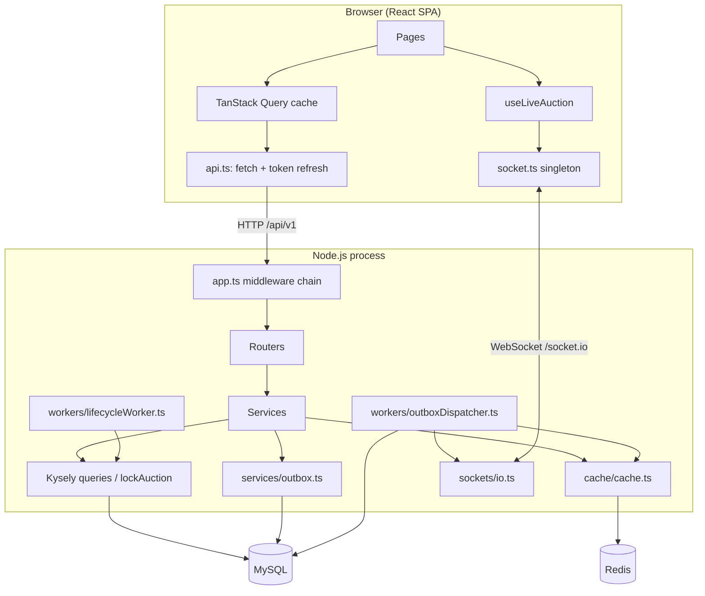

# Architecture

## Shape: a modular monolith

One Node.js process serves the REST API and Socket.IO and runs two background loops. Code is split
into modules with clear boundaries (routes → service → repository/SQL), so any module could become a
service later, but there is one deploy, one log stream, one database transaction boundary.

Why not microservices: the core invariant ("bid row and auction summary change together") lives in
one database transaction. Splitting bids and auctions into services would turn that into a
distributed transaction or a saga — far more complexity for no benefit at this scale.

In development the Vite server proxies `/api`, `/socket.io`, `/uploads` and `/static` to the API, so
the browser sees one origin. That keeps the refresh cookie first-party (SameSite=Strict works) and
avoids CORS for the SPA itself.

## Backend layers

| Layer | Example | Responsibility |
|---|---|---|
| Middleware | `middleware/auth.ts`, `validate.ts` | Cross-cutting HTTP concerns: identity, roles, validation, errors, limits |
| Routes (controllers) | `modules/auctions/auction.routes.ts` | Translate HTTP ↔ service calls. No SQL, no business rules |
| Services | `auction.service.ts`, `bids/bid.service.ts` | Business rules, transactions, locks, events |
| Repository | `auction.repository.ts` | Reusable queries and API shapes (`summaryQuery`, `loadAuctionDetail`, `lockAuction`) |
| Infrastructure | `database/db.ts`, `cache/redis.ts`, `sockets/io.ts` | Connections and adapters |
| Workers | `workers/*.ts` | Timed and post-commit work |

## Where state lives

| State | Store | Authority |
|---|---|---|
| Users, auctions, bids, notifications, sessions, audit | MySQL | **Source of truth** |
| Pending real-time events | MySQL `outbox_events` | Written atomically with the change |
| Auction snapshots, list pages, aggregates | Redis | Disposable copy; can be flushed anytime |
| Socket rooms, viewer counts, rate-limit counters, cache metrics | Process memory | Per instance |
| Access token | Browser memory | 15 min |
| Refresh token | HttpOnly cookie (hash in MySQL) | 7 days, rotating |

## Background work

- **Lifecycle worker** (1 s): activate due SCHEDULED lots, send one-time "ending soon" alerts, close
  ended ACTIVE lots. Each candidate is locked and re-checked.
- **Outbox dispatcher** (250 ms + immediate wake-up after each commit): publish events, invalidate
  cache, mark processed. Prunes processed rows older than a day, hourly.
- Both can be disabled with `DISABLE_WORKERS=true` (tests drive them explicitly).

## Startup and shutdown (`server.ts`)

Start: wait for MySQL with backoff (Docker's MySQL accepts connections a few seconds after it
"starts") → apply migrations (non-production) → connect Redis (continue without it if absent) →
create HTTP + Socket.IO → start workers → listen.

Stop on SIGINT/SIGTERM: stop workers (let an in-flight tick finish) → close Socket.IO and HTTP →
close Redis and the MySQL pool; force-exit after 10 s.

## Frontend structure

| Folder | Contents |
|---|---|
| `services/` | `api.ts` (fetch wrapper, in-memory access token, single-flight refresh), `socket.ts` (one connection, token-aware reconnects), `queries.ts` (query keys and fetchers) |
| `context/` | `AuthContext` (session restore), `NotificationsContext` (bell + toasts from `notification:new`), `LiveFeedContext` (price ticks for cards) |
| `features/bidding/` | `useLiveAuction` (room subscription, resync), `applyEvent` (pure version-ordering reducer), `BidPanel`, `BidHistory`, `ActivityFeed` |
| `features/auctions/` | Cards, `Countdown` (server-corrected clock), `PriceRoll`, gallery, watch toggle |
| `pages/` | Route screens, role-specific ones code-split |
| `components/ui/` | Small accessible primitives on Radix |

Business rules stay on the server; the UI only mirrors them for feedback (e.g. it pre-checks the
minimum bid, but the server decides).
