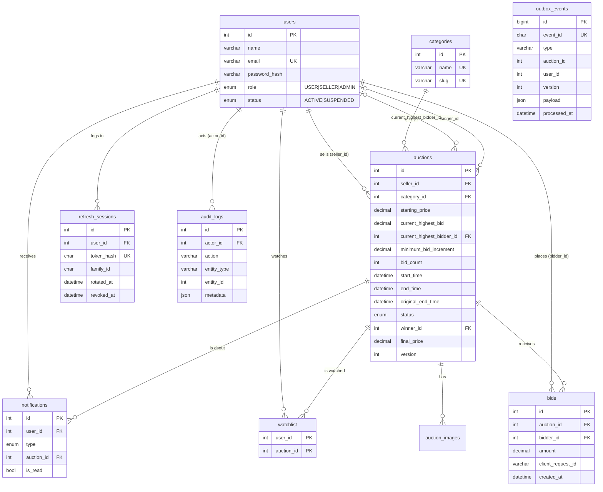

# Database design

MySQL 8, InnoDB, `utf8mb4`. Schema: [`backend/database/migrations/001_init.sql`](../backend/database/migrations/001_init.sql).
Typed mirror for queries: [`backend/src/database/types.ts`](../backend/src/database/types.ts).

## Entity–relationship diagram

## Tables

| Table | Purpose |
|---|---|
| `users` | Accounts. `role` drives RBAC; `status = SUSPENDED` blocks login and every authenticated request. |
| `categories` | Departments (Watches, Electronics, Art, Collectibles, Sneakers). |
| `auctions` | The lot and its **live summary** (`current_highest_bid`, leader, `bid_count`, `version`). |
| `auction_images` | Ordered images; `display_order = 0` is the cover. |
| `bids` | Append-only history of **accepted** bids. Rejected bids are never stored. |
| `watchlist` | Composite-key join of users and auctions. |
| `notifications` | Durable per-user alerts; the bell reads these. |
| `refresh_sessions` | Hashed refresh tokens, rotation and revocation (token families). |
| `audit_logs` | Who did what: creation, publication, bids, cancellations, completions, admin actions. |
| `outbox_events` | Transactional outbox for post-commit Socket.IO delivery. |
| `schema_migrations` | Applied migration file names (created by the runner). |

### Why are Auction and Bid separate tables?

A bid is a fact with its own identity, time and bidder, and an auction has many of them — classic
one-to-many, so a separate table (normalisation). The auction row also keeps a **denormalised
summary** (`current_highest_bid`, `current_highest_bidder_id`, `bid_count`) so that the hot path —
"what's the price now?" — is a primary-key read rather than an aggregate over bids. The two are kept
consistent because they're written in the same transaction under the auction row lock; the closing
worker cross-checks them anyway.

### How is the highest bidder determined?

Bids must strictly increase (each ≥ previous + increment), so the latest accepted bid is also the
highest. The summary columns record it on every accepted bid. At close, `winner_id` and `final_price`
are copied from the summary after cross-checking against `ORDER BY amount DESC, id ASC LIMIT 1`.

## Constraints

| Constraint | Protects against |
|---|---|
| `uq_users_email` | Duplicate accounts (emails are lower-cased before insert). |
| `uq_bids_bidder_request (bidder_id, client_request_id)` | Double-inserting a retried bid. Scoped per bidder. |
| `uq_auction_images_order (auction_id, display_order)` | Two "cover" images. |
| `uq_refresh_token_hash`, `uq_outbox_event_id` | Duplicate tokens / events. |
| `ck_auctions_starting_price`, `ck_auctions_increment`, `ck_bids_amount` | Zero or negative money. |
| `ck_auctions_window (end_time > start_time)` | Impossible schedules. |
| `ck_auctions_highest (current_highest_bid ≥ starting_price)` | A summary below the opening price. |
| `ck_auctions_leader_pair` | A price without a leader or a leader without a price. |
| Foreign keys | Orphans (bids for missing auctions, etc.). |

MySQL does not allow a CHECK constraint on a column used by a foreign key with `ON DELETE SET NULL`,
so `fk_auctions_leader` is `RESTRICT`. That is the right behaviour anyway: a user who is leading an
auction has bids, and bids are `RESTRICT` too.

### `ON DELETE` behaviour

| FK | Rule | Reason |
|---|---|---|
| auctions → users (seller), bids → users | `RESTRICT` | Never erase trading history by deleting a user; suspend instead. |
| auctions → categories | `RESTRICT` | A department with lots cannot vanish. |
| auction_images, bids, watchlist → auctions | `CASCADE` | They have no meaning without the auction (auctions are cancelled, not deleted, in practice). |
| notifications → users, watchlist → users, refresh_sessions → users | `CASCADE` | Personal data goes with the account. |
| winner, notification → auction, audit actor | `SET NULL` | Keep the record, drop the pointer. |

## Indexes and the queries they serve

| Index | Query |
|---|---|
| `auctions (status, end_time)` | Worker: `status='ACTIVE' AND end_time <= now`; "ending soon" sort |
| `auctions (status, start_time)` | Worker: `status='SCHEDULED' AND start_time <= now` |
| `auctions (seller_id, status)` | Seller dashboard, "my listings" |
| `auctions (category_id, status)` | Browse by department |
| `auctions (status, is_featured)` | Featured strip |
| `auctions (current_highest_bidder_id)`, `(winner_id)` | "Auctions I'm winning / won" |
| `bids (auction_id, created_at)` | Bid history, newest first |
| `bids (auction_id, amount)` | Highest-bid cross-check at close |
| `bids (bidder_id, created_at)` | "My bids" dashboard |
| `notifications (user_id, is_read, created_at)` | Unread count and bell list |
| `outbox_events (processed_at, id)` | Dispatcher's "unprocessed, oldest first" |
| `audit_logs (entity_type, entity_id)`, `(actor_id, created_at)`, `(created_at)` | Audit lookups |

A **composite index** is ordered by its first column, then the second within it — so
`(status, end_time)` answers "ACTIVE ones, ordered by end time" with one range scan, but cannot help a
query that filters only on `end_time`.

## Money and time

- `DECIMAL(12,2)`: exact base-10 storage. `FLOAT`/`DOUBLE` are binary: 0.1 has no exact
  representation, so equality and ordering of amounts can be wrong by a paisa. mysql2 is configured
  with `decimalNumbers: false`, so values arrive as strings; the server uses decimal.js and the UI uses
  integer paise (`BigInt`).
- Range: bids are capped at ₹10,00,00,000 in validation; the column holds up to 9,999,999,999.99.
- Currency: INR only, documented in the API.
- `DATETIME(3)` in UTC. The pool sets `timezone: 'Z'` (driver) and `SET time_zone = '+00:00'`
  (session), and transactions read `UTC_TIMESTAMP(3)`. The UI converts to the viewer's timezone.

## Migrations

`npm run db:migrate` runs `backend/scripts/db.ts migrate`, which applies `database/migrations/*.sql`
in filename order and records each in `schema_migrations`. MySQL DDL commits implicitly, so a
migration is not atomic; keep each file small and additive. `npm run db:reset` drops all tables,
re-migrates and reseeds (refused in production).

## Seed data

`npm run db:seed` (`backend/database/seed/seed.ts`) truncates and recreates: 8 users (1 admin, 2
sellers, 5 bidders), 5 categories, 25 lots across every status with timings relative to "now"
(several ending within minutes), 140 bids from a fixed-seed PRNG with valid increasing ladders,
watchlist entries and notifications. Images are original SVG illustrations in `backend/assets/seed`
(generator: `database/seed/generate-art.py`).
