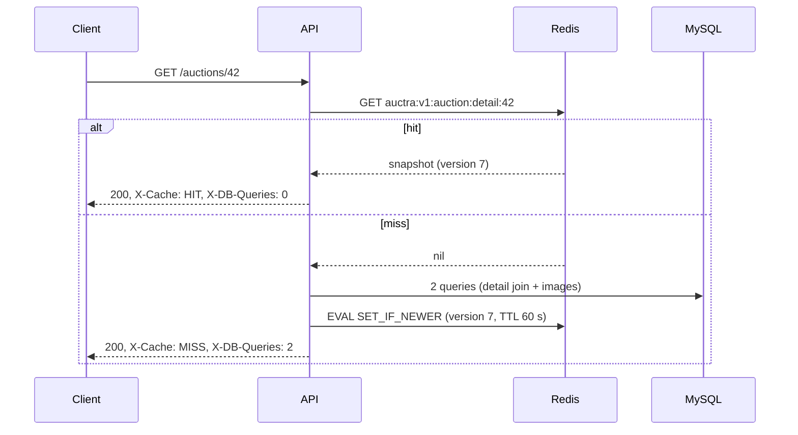
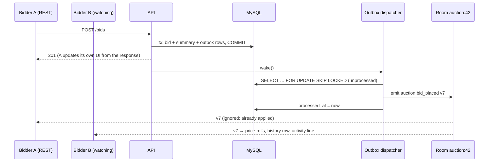

# Redis caching and WebSockets

## Part 1 — Redis cache-aside

Code: [`backend/src/cache/`](../backend/src/cache). Redis is **never** the source of truth and is
**never** read when deciding a bid.

### Read path



### Write path (after commit)

`invalidateAuction(id, committedVersion)` runs an atomic Lua script: raise
`auction:minver:{id}` to `committedVersion` (if higher) and `DEL auction:detail:{id}`; then `INCR`
the list generation and delete featured/stats/category/admin aggregates. It runs **after** COMMIT
(in the request) and again from the outbox dispatcher — idempotent, so doing it twice is harmless and
covers a crash in between.

### The stale-repopulation race and how versions close it

1. Reader R misses and loads version 5 from MySQL (slow).
2. A bid commits version 6 and invalidates (deletes the key).
3. R finishes and writes version 5 back → the cache now serves stale data for up to the TTL.

`setAuctionSnapshot` uses a Lua script (`SET_IF_NEWER`) that refuses to write when the snapshot's
version is below `minver` or below the version already cached. Step 3 becomes a no-op and is counted
in `skippedStaleWrites`. Tested in `tests/integration/cache.test.ts`.

**Remaining window:** between COMMIT and the invalidation call (sub-millisecond, same process), a
reader can still be served the previous snapshot. Live viewers are corrected by the socket event,
and the bid path never reads the cache, so this can't affect correctness — only freshness for a
fraction of a millisecond.

### List caching without key scans

Browse pages are cached under `auctions:list:{generation}:{hash(query)}` for 20 s. Any change that
could affect a listing bumps the generation counter; old pages become unreachable and expire. This
avoids `KEYS`/`SCAN` and makes invalidation O(1).

### Keys and TTLs

| Key | TTL | Invalidated by |
|---|---|---|
| `auctra:v1:auction:detail:{id}` | 60 s | bids, lifecycle, edit, publish, cancel, feature |
| `auctra:v1:auction:minver:{id}` | 300 s | (written by invalidation) |
| `auctra:v1:auctions:list:{gen}:{hash}` | 20 s | generation bump |
| `auctra:v1:auctions:featured` | 30 s | any auction change |
| `auctra:v1:categories:all` | 1 h | any auction change (live counts) |
| `auctra:v1:stats:public` | 30 s | any auction change |
| `auctra:v1:dashboard:summary` | 15 s | any auction change |

Private data (notifications, a user's bids, watchlists) is not cached.

### Redis failure

The client uses `enableOfflineQueue: false`, `maxRetriesPerRequest: 1`, 1 s command timeout and
background reconnection. Every cache call is wrapped: on error the request reads MySQL and the
response says `X-Cache: BYPASS`. `/health/ready` reports `degraded`. Tested by disconnecting Redis
mid-test.

### Instrumentation

`cache/metrics.ts` counts hits, misses, errors and skipped stale writes per area; visible at
`/api/v1/dev/cache/metrics` (dev) and in the admin dashboard's System panel. `X-DB-Queries` counts SQL
statements per request via `AsyncLocalStorage`. `npm run demo:cache` prints all of it;
`npm run bench` measures throughput and latency.

### Cache stampede

If a hot key expires, many concurrent requests can all miss and hit MySQL at once. Here that costs
two indexed queries each, and the versioned write means they can't corrupt anything. At larger scale
you would add request coalescing (single-flight per key), a short lock key, or stale-while-revalidate.

---

## Part 2 — WebSockets (Socket.IO)

Code: [`backend/src/sockets/io.ts`](../backend/src/sockets/io.ts), contracts in
[`shared/events.ts`](../backend/src/shared/events.ts) (mirrored in `frontend/src/types/events.ts`),
client in [`frontend/src/features/bidding/useLiveAuction.ts`](../frontend/src/features/bidding/useLiveAuction.ts).

### Rooms

| Room | Who joins | Receives |
|---|---|---|
| `auction:{id}` | anyone viewing the lot (`auction:join`) | `bid_placed`, `started`, `ending_soon`, `ended`, `cancelled`, `viewers` |
| `user:{id}` | sockets with a valid access token (automatic) | `notification:new` |
| `feed` | every page (`feed:join`) | `price_updated` for listing cards |

Authorisation: the handshake token (optional) is verified; an invalid token is refused so the client
refreshes it. Joining a DRAFT auction room requires being its seller or an admin.

### Event envelope

```jsonc
{
  "eventId": "6c1f…",            // unique; clients drop duplicates
  "type": "auction:bid_placed",
  "auctionId": 42,
  "version": 7,                   // auction version AFTER this change
  "occurredAt": "2026-10-13T07:27:08.052Z",
  "data": { "bid": { … }, "state": { "currentHighestBid": "11000.00", "minimumNextBid": "11100.00", … }, "extended": false }
}
```

### Flow of one bid



### Client rules

- **Version ordering** (`applyEvent.ts`): `≤ current` ignore; `= current + 1` apply; `> current + 1`
  → refetch the detail over REST.
- **Dedup** by `eventId` (at-least-once delivery).
- **Reconnect:** socket.io-client retries with backoff (0.5–5 s). On `connect`, the page re-joins and
  compares the ack's `version`; if the server is ahead, it refetches detail and bid history. The
  notification bell also refetches on reconnect.
- **Cleanup:** all listeners are attached in one effect and removed in its cleanup, and the room is
  left; rooms are sets, so duplicate joins are no-ops.
- **Token changes:** the socket's `auth` is a function, so each reconnect sends the current token; on
  login/logout the socket reconnects to join/leave the user room.

### Can messages be lost?

Yes — a client can be offline, and a server can crash after commit but before emitting. Auctra
treats sockets as a fast notification channel, not a ledger: missed events are recovered by the
outbox (server side) and by version-gap detection plus REST refetch (client side). Notifications are
also stored in MySQL, so the bell is correct after any outage.

### Why REST for bids and sockets for updates?

A bid needs authentication, validation, rate limiting, an idempotency key and a definite answer
(201/409…) tied to a committed transaction — exactly what an HTTP request/response gives you, and
it's trivially testable and retryable. Sockets are for fan-out of facts that have already happened.

### Multiple API instances (not implemented)

Rooms are per process. With several instances, add `@socket.io/redis-adapter`: `io.to(room).emit`
publishes through Redis Pub/Sub so every instance delivers to its own clients. Sticky sessions are
needed if the polling transport is enabled. The outbox already supports multiple dispatchers.
