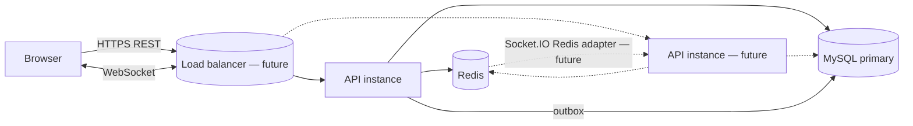

# System design

This document describes Auctra as a system: requirements, guarantees, failure behaviour and how it
would scale. It separates **what is implemented** from **what would be future work**.

## 1. Requirements

### Functional

- Accounts with roles (bidder, seller, admin); sign up, sign in, sessions that survive reloads.
- Sellers create, schedule, publish, edit and cancel listings with images.
- Bidders browse/search/filter, watch lots, place bids, see live updates and outbid alerts.
- Auctions open and close automatically; the highest valid bid wins; everyone involved is notified.
- Administrators manage users, moderate listings and see platform health.

### Non-functional

| Property | Target | How |
|---|---|---|
| **Correctness of bids** | Never accept an invalid bid; never lose an accepted one; one consistent winner | ACID transaction + row lock + constraints |
| **Durability** | An accepted bid survives any later failure | Committed to MySQL before the response |
| **Freshness** | Viewers see a new bid within ~1 s | Outbox dispatcher woken on commit; Socket.IO |
| **Read performance** | Popular lot pages don't hammer the DB | Versioned Redis cache-aside |
| **Availability** | Bidding keeps working if Redis or sockets fail | Both are optional paths |
| **Security** | No privilege escalation, no token theft via XSS, no CSRF | See SECURITY.md |
| **Operability** | Diagnose problems quickly | Request IDs, structured logs, health checks, metrics |

## 2. Consistency model

- **Bidding: strong consistency (linearizable per auction).** All writers to an auction serialise on
  its row lock and see the latest committed state. This is non-negotiable: money and a single winner.
- **Reads of auction pages: eventually consistent, bounded.** A cached snapshot may lag a commit by
  at most the time between commit and invalidation (sub-millisecond in-process), and never by an
  older version once invalidated (version guard). Live viewers are corrected by events.
- **Lists and aggregates:** eventually consistent within their TTL (15–30 s) or the next generation
  bump.
- **Notifications:** durable and exactly-once in MySQL; real-time delivery is at-least-once.

## 3. Architecture



Implemented: one API process with in-process workers, MySQL, Redis. Dashed: scale-out additions.

## 4. Bid submission sequence

```mermaid
sequenceDiagram
  autonumber
  participant U as Bidder
  participant API
  participant DB as MySQL
  participant R as Redis
  participant OD as Outbox dispatcher
  participant V as Viewers
  U->>API: POST /auctions/42/bids {amount, clientRequestId}
  API->>API: authenticate, rate limit, validate
  API->>DB: BEGIN; SELECT … FOR UPDATE (+ UTC_TIMESTAMP)
  API->>DB: idempotency lookup
  API->>API: rules on locked row
  API->>DB: INSERT bid; UPDATE auction (version+1)
  API->>DB: INSERT notifications, outbox, audit
  API->>DB: COMMIT
  API->>R: invalidate (versioned)
  API->>OD: wake
  API-->>U: 201 {bid, state, version}
  OD->>DB: claim events (SKIP LOCKED)
  OD->>V: emit auction:bid_placed / notification:new
  OD->>DB: mark processed
```

## 5. Cache flow and WebSocket flow

See [REDIS_WEBSOCKETS.md](REDIS_WEBSOCKETS.md) for diagrams of the read path, invalidation, the
stale-write guard, room fan-out and client resync.

## 6. Data model

See [DATABASE.md](DATABASE.md). The two choices that matter for system design: a **denormalised
summary on the auction row** (O(1) price reads, consistent because it's written under the lock), and
the **outbox table** (events are part of the same transaction as the change).

## 7. Failure scenarios

| Scenario | Current behaviour | Future work |
|---|---|---|
| **MySQL unavailable** | Startup retries with backoff; requests fail with 500 (generic message, logged with request ID); `/health/ready` returns 503. No bid can be accepted — correct, since none could be recorded. Cached pages may still be served until TTL. | Primary/replica failover (e.g. managed MySQL), circuit breaker returning 503 quickly. |
| **Redis unavailable** | Every cache call fails fast (no offline queue, 1 s timeout) → MySQL; `X-Cache: BYPASS`; `/health/ready` = `degraded`; auto-reconnect. Bidding unaffected. **Tested.** | Redis replica / Sentinel; rate limits would need a fallback if moved to Redis. |
| **Client disconnects** | socket.io-client reconnects with backoff; page re-joins, compares versions, refetches. Notifications are in MySQL and the bell refetches. **Tested** (version gap on rejoin). | Optional per-event replay from the outbox for short gaps. |
| **Backend crashes during bid processing** | Before COMMIT: MySQL rolls the transaction back when the connection drops — no partial bid. After COMMIT, before the response: the bid stands; the client sees a network error and retries with the same `clientRequestId` → `200 replayed`. After COMMIT, before emit: outbox rows are still unprocessed and are emitted after restart. | — |
| **Duplicate request** | Unique `(bidder_id, client_request_id)` + lookup under the lock → original result. **Tested concurrently.** | — |
| **Simultaneous bids** | Serialised by the row lock; each re-validated against committed state. **Tested up to 100 concurrent.** | — |
| **Late scheduler** | Bids check `now < end_time` on the DB clock regardless of status, so nothing is accepted after the end; the next tick closes the lot. Scheduled lots also activate lazily on the first valid bid. **Tested.** | — |
| **Multiple backend instances** | Lifecycle: safe (lock + re-check, idempotent; **tested with 8 concurrent closers**). Outbox: safe to run several dispatchers (`SKIP LOCKED`). **Not handled:** socket rooms are per process; in-memory rate limits and metrics are per process. | `@socket.io/redis-adapter`, Redis-backed rate limiting, centralised metrics. |
| **Post-commit notification failure** | Notification rows are already committed; outbox retries emission (up to 10 attempts, error recorded). Clients recover via REST. | Dead-letter alerting on `attempts ≥ 10`. |
| **Deadlock / lock timeout** | Whole transaction retried ≤ 3× with jitter; then `503 CONFLICT_RETRY_EXHAUSTED` (safe to retry). **Real deadlock tested.** | — |
| **Clock skew between servers** | Irrelevant to correctness: all decisions use `UTC_TIMESTAMP` from MySQL. UI countdowns correct for client skew using `serverTime`. | — |

## 8. Bottleneck analysis

1. **A single hot auction.** Bids on one lot are serial by design. With ~10 statements per bid the
   measured ceiling on a 2-vCPU VM was ~76 accepted bids/s on one auction. Real auctions rarely see
   more than a few bids per second even at the end; if one did, reduce work inside the lock (move
   audit/notifications to the outbox consumer) before considering anything exotic.
2. **Database connections.** Every waiting bidder holds a pooled connection while blocked. The pool
   (default 20) bounds this; excess requests queue in the pool. Tune pool size against
   `max_connections`, and keep transactions short.
3. **Read traffic.** Absorbed by Redis for lot pages and lists; MySQL handles misses.
4. **Socket fan-out.** One emit per room member per event; a single Node process handles thousands of
   idle sockets, but CPU per event grows with viewers. Scale horizontally with the Redis adapter.
5. **Workers in the API process.** Fine at this scale; at higher load they'd move to a separate
   process so API latency isn't affected.

## 9. Scaling path

| Users | What changes |
|---|---|
| ~100 concurrent | Current design as is. |
| ~10,000 browsing | Several API instances behind a load balancer; Redis adapter for Socket.IO; Redis-backed rate limits; CDN for images and the SPA; read replica for browse/search (never for bids). |
| ~1,000,000 | Partition hot paths: search in a dedicated engine (OpenSearch); notifications and audit written via the outbox to a queue consumer; dedicated socket gateway tier; sharding auctions by ID if a single primary's write throughput is exceeded (bids for one auction stay on one shard, so the locking model is unchanged). |

Kafka or similar becomes useful when many independent consumers need the event stream (analytics,
search indexing, email). For the current single consumer, the outbox table is simpler and sufficient.

## 10. Deployment considerations

- Build: `npm run build`; run `node backend/dist/src/server.js` with `NODE_ENV=production`
  (migrations via `npm run db:deploy` in a release step, not on boot); serve `frontend/dist` from a
  CDN or the same reverse proxy that routes `/api` and `/socket.io` to the API.
- TLS at the proxy; `trust proxy` set to the real hop count; `Secure` cookies are automatic in production.
- Secrets from a secret manager; distinct `JWT_ACCESS_SECRET` per environment.
- Health: `/health/live` for liveness, `/health/ready` for readiness.
- Logs are JSON on stdout (ship to a log store). Request IDs tie a user report to server logs.
- Real payments would add: a payment intent created when an auction is won, a "payment due" state
  with a deadline, second-chance offers to the runner-up on non-payment, escrow and refunds — all
  driven by outbox events, never inside the bid transaction.

## 11. Monitoring (future)

Key signals: bid latency p95/p99 and `CONFLICT_RETRY_EXHAUSTED` rate; lock wait time
(`performance_schema.data_lock_waits`); pool queue length; outbox backlog and oldest pending event
age (already exposed in diagnostics); cache hit rate (exposed); socket connections and emit rate;
lifecycle lag (now − end_time for ACTIVE lots past their end). Export with Prometheus/OpenTelemetry and
alert on outbox age and lifecycle lag.

## 12. Design trade-offs

- **Pessimistic vs optimistic locking:** pessimistic gives an orderly queue on hot lots; optimistic
  avoids blocking but wastes work under contention. Chosen: pessimistic, with a version guard as a
  safety net.
- **Outbox vs direct emit:** direct emit is simpler and ~instant but can announce rolled-back changes
  or lose events on crash. The outbox costs one insert per event and a dispatcher.
- **Monolith vs services:** the bid invariant spans two tables in one transaction; a monolith keeps
  it a local transaction.
- **Cache granularity:** per-auction snapshots with versions (precise, cheap to invalidate) and
  short-TTL list pages with a generation counter (coarse but O(1) invalidation).
